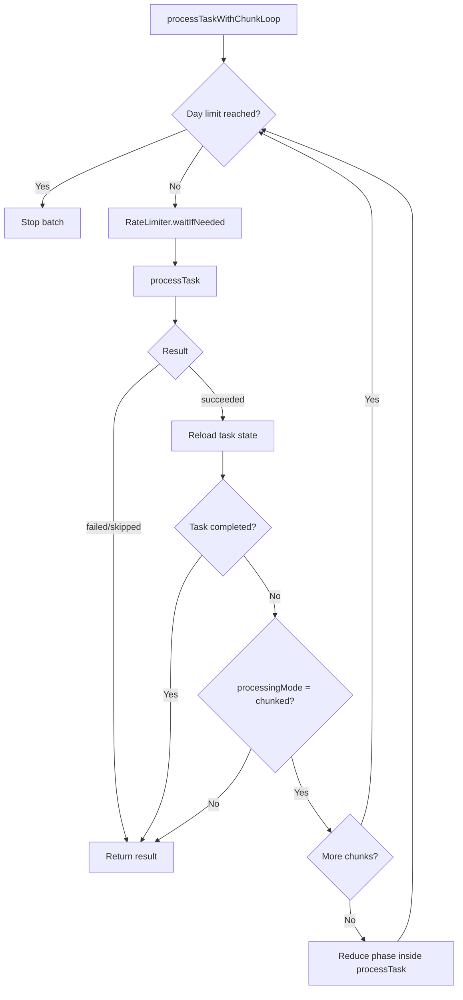

# PoliTopicsRecap Fargate Architecture

## Overview

PoliTopicsRecap runs as an ECS Fargate task that is triggered once daily by EventBridge Scheduler. The container processes pending LLM tasks with configurable rate limiting and exits when complete. Lambda-based execution has been removed.

## Architecture Diagram

```
EventBridge Scheduler (1日1回 / Once daily)
         │
         ▼
   ECS Fargate Task (起動 / Start)
         │
         ▼
   ┌─────────────────────────────────────┐
   │  Recap Container                    │
   │  ├── Rate Limiter (configurable)    │
   │  ├── Task Loop                      │
   │  │   ├── Fetch pending tasks        │
   │  │   ├── Process with rate limit    │
   │  │   └── Repeat until done/limit    │
   │  └── Exit with code 0/1             │
   └─────────────────────────────────────┘
         │
         ▼
   Container終了 → Fargate Task終了
```

## Processing Flow

```mermaid
flowchart TD
  A[Start] --> B[Count ready tasks]
  B --> C[Set maxTasks = max(RPD, ready)]
  C --> D{Requeue completed w/ major prompt mismatch?}
  D -->|Yes| E[Requeue up to cap]
  D -->|No| F
  E --> F[Loop while processed < maxTasks]

  F --> G{Fetch next task}
  G -->|None| H[Exit 0]
  G -->|Found| I[processTaskWithChunkLoop]

  I --> J{Day limit reached?}
  J -->|Yes| H
  J -->|No| K[RateLimiter.waitIfNeeded]
  K --> L[processTask]

  L --> M{Result}
  M -->|succeeded| N[Stats: succeeded]
  M -->|failed| O[Stats: failed + cooldown]
  M -->|skipped| P[Stats: skipped]

  N --> Q[Stats: processed++]
  O --> Q
  P --> Q
  Q --> F
```

## Chunked Task Subflow



## Configuration

### Rate Limit Settings (config.ts)

```typescript
rateLimit: {
  requestsPerMinute: number; // RPM制限 (default: 15)
  requestsPerDay: number; // 日次リクエスト上限 (default: 1500)
  maxConsecutiveErrors: number; // 連続エラー閾値 (default: 5)
  cooldownOnErrorMs: number; // エラー時の待機時間 (default: 30000)
}

batch: {
  maxTasksPerRun: number | "auto"; // 'auto' = max(requestsPerDay, pending tasks)
  gracefulShutdownTimeoutMs: number; // シャットダウン待機時間 (default: 10000)
}

chunking: {
  // chunk packing uses this ratio of available input tokens
  CHUNK_PACKING_TOKEN_BUDGET_RATIO: number; // default: 0.85
  // single_chunk is allowed only when speech count is below this threshold
  SINGLE_CHUNK_MAX_SPEECHES: number; // default: 40
  // single_chunk is allowed only when estimated token usage is below this ratio
  SINGLE_CHUNK_MAX_TOKEN_USAGE_RATIO: number; // default: 0.5
}
```

### Environment Variables

| Variable                | Description                                             | Required          |
| ----------------------- | ------------------------------------------------------- | ----------------- |
| `APP_ENVIRONMENT`       | Environment (prod/stage/local)                          | Yes               |
| `LLM_PROVIDER`          | `anthropic` (default) or `gemini` (rollback)            | No                |
| `ANTHROPIC_API_KEY`     | Anthropic API key (on Fargate: injected from SSM Parameter Store) | Yes (prod/stage, when `LLM_PROVIDER=anthropic`) |
| `ANTHROPIC_MODEL`       | Claude model (default: `claude-haiku-5-5`)              | No                |
| `ANTHROPIC_EFFORT`      | `output_config.effort`: `low`/`medium`/`high`/`xhigh`/`max` (default: `medium`) | No |
| `ANTHROPIC_TIMEOUT_MS`  | Timeout for one Claude call, retries included (default: 600000) | No        |
| `ANTHROPIC_MAX_INPUT_TOKEN`  | Claude input budget per chunk (default: 64000)     | No                |
| `ANTHROPIC_MAX_OUTPUT_TOKEN` | Claude `max_tokens` (default: 64000)               | No                |
| `GEMINI_API_KEY`        | Gemini API key                                          | Yes (prod/stage, when `LLM_PROVIDER=gemini`) |
| `GEMINI_MAX_INPUT_TOKEN`  | Gemini max input tokens (default: 64000 in prod/stage) | No               |
| `GEMINI_MAX_OUTPUT_TOKEN` | Gemini max output tokens (default: 64000)               | No               |
| `CHUNK_PACKING_TOKEN_BUDGET_RATIO` | Ratio of available input tokens used for chunk packing (default: 0.85) | No |
| `SINGLE_CHUNK_MAX_SPEECHES` | Max speech count to allow `single_chunk` (default: 40) | No |
| `SINGLE_CHUNK_MAX_TOKEN_USAGE_RATIO` | Max token usage ratio to allow `single_chunk` (default: 0.5) | No |
| `DISCORD_WEBHOOK_ERROR` | Error notification webhook                              | Yes               |
| `DISCORD_WEBHOOK_WARN`  | Warning notification webhook                            | Yes               |
| `DISCORD_WEBHOOK_BATCH` | Batch notification webhook                              | Yes               |
| `R2_WRITE_ENDPOINT_URL` | Cloudflare R2 endpoint URL                              | Yes (prod/stage)  |
| `R2_ACCESS_KEY_ID`      | R2 access key ID                                        | Yes (prod/stage)  |
| `R2_SECRET_ACCESS_KEY`  | R2 secret access key                                    | Yes (prod/stage)  |
| `R2_ARTICLE_BUCKET`     | R2 bucket for article assets                            | No (uses default) |
| `R2_REGION`             | R2 region (default: "auto")                             | No                |
| `R2_PUBLIC_ASSET_URL`   | R2 public URL (default: "https://asset.politopics.net") | No                |

## LLM Provider

Recap generates summaries with **Claude Haiku 5.5** (`claude-haiku-5-5`) through the Anthropic API by default. Gemini stays selectable for rollback (`LLM_PROVIDER=gemini`, Terraform `llm_provider = "gemini"`).

- **Client**: `src/llm/anthropicClient.ts` (`@anthropic-ai/sdk`). Requests are streamed (`messages.stream(...).finalMessage()`), because the SDK refuses non-streaming calls with a large `max_tokens`. `ANTHROPIC_TIMEOUT_MS` bounds the whole call including the SDK's 2 retries (408/409/429/5xx and connection errors).
- **Parameters**: `model`, `max_tokens` (`ANTHROPIC_MAX_OUTPUT_TOKEN`; 8000 for the missing-dialog recovery call, because thinking counts toward `max_tokens`), `output_config.effort` (`ANTHROPIC_EFFORT`, default `medium`). Adaptive thinking is the model default, so `thinking` is not sent. `temperature`/`top_p`/`top_k` and assistant prefill are never sent (Claude Haiku 5.5 rejects them).
- **JSON output**: Claude gets a short Japanese system instruction to answer with the bare JSON object (no preface, no code fences). The shared prompts and `PROMPT_VERSION` are unchanged, so completed tasks are not requeued.
- **Response handling**: only `text` blocks are read (thinking blocks come first). `stop_reason: "refusal"` fails the task with the refusal category in the logs (Claude Haiku 5.5 has no server-side fallback). On `max_tokens` / `model_context_window_exceeded` the truncated JSON is never stored and the chunk is not marked completed. When the chunk step of a chunked task stops at `max_tokens` (thinking counts toward the cap), the task is remade with smaller chunks; a cut-off reduce step or single_chunk task fails the task. API errors keep their SDK class and status, so a 400 "prompt is too long" (or 413) still remakes the task with smaller chunks. A call stopped by `ANTHROPIC_TIMEOUT_MS` fails the task and is not remade, so keep the timeout long enough for `ANTHROPIC_MAX_OUTPUT_TOKEN` tokens to stream.
- **Logging**: message id, `stop_reason` and usage (input/output/thinking/cache tokens) for every call; status, request ID and error code for failures. The API key and prompts are never logged.
- **Token counting**: chunk packing counts tokens with `messages.countTokens` and the generation model (the tokenizer differs from Gemini's). Empty text counts as 0 without a request. Counts are estimates that can run a few tokens high, which only makes chunks slightly smaller. Token counting is free but rate limited per usage tier.
- **Task `llm` values**: tasks are tagged `anthropic`, `gemini` or `fake`. Both `anthropic` and `gemini` run on the active provider: tasks prepared for Gemini before the switch finish on Claude (with a warning), and the same happens in reverse on rollback. `task.llmModel` is used only when it belongs to the active provider. `fake` keeps the echo test client; unknown values are skipped.
- **API key on Fargate**: Terraform passes `ANTHROPIC_API_KEY` to the container from the SSM Parameter Store SecureString `/politopics/<env>/recap/anthropic-api-key` through ECS `secrets`, so the key is not in Terraform state, the task definition or GitHub. Create the parameter before deploying (see `terraform/README.md`).
- **Smoke test** (real API, opt-in): read the key first with `read -rs ANTHROPIC_API_KEY && export ANTHROPIC_API_KEY` (a key typed into the command line stays in the shell history), then run `RUN_ANTHROPIC_SMOKE_TEST=true APP_ENVIRONMENT=localstackTest ENABLE_NOTIFICATION=false ./node_modules/.bin/jest --config jest.config.ts --runInBand src/llm/anthropicClient.smoke.test.ts` and `unset ANTHROPIC_API_KEY` afterwards.

## Storage Architecture

Task chunk metadata:
- `chunks[].based_on_orders` stores the covered speech orders for each chunk.
- During reduce prompt assembly, Recap passes this coverage into input (`[chunk orders] ...`).
- Backward compatibility: when old tasks do not have `based_on_orders`, Recap falls back to parsing chunk outputs and URL patterns.

### Cloudflare R2 Integration

Article assets (summaries, dialogs) are stored in Cloudflare R2 instead of AWS S3 for cost savings and edge performance.

#### Public Access via Custom Domain

Assets are served publicly via `asset.politopics.net`:

```
Frontend (politopics.net)
       │
       ├── API Request ────► api.politopics.net ────► DynamoDB (metadata only)
       │                          │
       │                          ▼
       │                     { article, assetUrl }
       │
       └── Asset Request ──► asset.politopics.net ──► R2 (CDN cached)
                                   │
                                   ▼
                              { summary, dialogs, ... }
```

#### Data Flow

1. **API Response**: Backend returns article metadata with `assetUrl`
2. **Asset Fetch**: Frontend fetches asset directly from R2 via public URL
3. **Merge**: Frontend merges metadata + asset for display

This architecture provides:

- **Faster API responses**: No S3/R2 reads in backend
- **CDN caching**: Assets cached at Cloudflare edge
- **Zero egress cost**: R2 has no egress fees

### R2 Configuration

R2 uses S3-compatible API. The configuration is set per environment:

| Environment | R2 Enabled | Bucket                    | Public URL                   |
| ----------- | ---------- | ------------------------- | ---------------------------- |
| local       | No         | LocalStack S3             | N/A                          |
| stage       | Yes        | politopics-articles-stage | https://asset.politopics.net |
| prod        | Yes        | politopics-articles-prod  | https://asset.politopics.net |

### Cloudflare Dashboard Setup (Required)

To enable public access via custom domain:

1. **R2 Bucket Settings** → Connect Custom Domain → `asset.politopics.net`
2. **CORS Configuration**:
   ```json
   [
     {
       "AllowedOrigins": ["https://politopics.net", "https://*.politopics.net"],
       "AllowedMethods": ["GET", "HEAD"],
       "AllowedHeaders": ["*"],
       "MaxAgeSeconds": 86400
     }
   ]
   ```
3. **Cache Rules**: Set `Cache-Control: public, max-age=31536000, immutable` for `/articles/*`

## Exit Codes

| Code | Meaning                          | Action             |
| ---- | -------------------------------- | ------------------ |
| 0    | All tasks completed successfully | Normal termination |
| 1    | Max consecutive errors reached   | Error termination  |

## AWS Resources

### ECS Fargate

- **Cluster**: `politopics-recap-{env}`
- **Task Definition**: `politopics-recap-task-{env}`
- **CPU**: 256 (0.25 vCPU)
- **Memory**: 512 MB

### ECR

- **Repository**: `politopics-recap`
- **Image Tag**: `{env}-{git-sha}`

### EventBridge Scheduler

- **Schedule**: `cron(0 9 * * ? *)` (9:00 AM JST daily)
- **Target**: ECS Fargate Task

### IAM Roles

- **Task Execution Role**: Pull ECR images, CloudWatch logs, read the Anthropic API key parameter (`ssm:GetParameters` on that parameter only, when `llm_provider = "anthropic"`)
- **Task Role**: DynamoDB, S3, SQS access

## Local Testing

### With Docker Compose (LocalStack)

```bash
# Start LocalStack and app
docker-compose up -d

# Run container in batch mode
docker-compose run --rm app-batch
```

### Manual Container Run

```bash
# Build image
docker build -t politopics-recap:local .

# Run with LocalStack
docker run --rm \
  --network politopics-network \
  -e APP_ENVIRONMENT=local \
  -e AWS_ENDPOINT=http://localstack:4566 \
  politopics-recap:local
```
